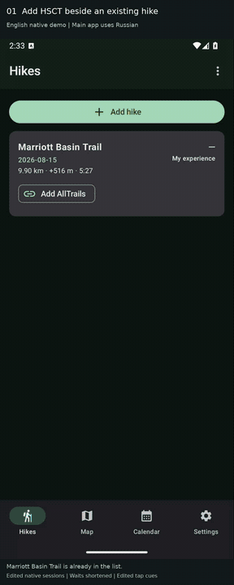
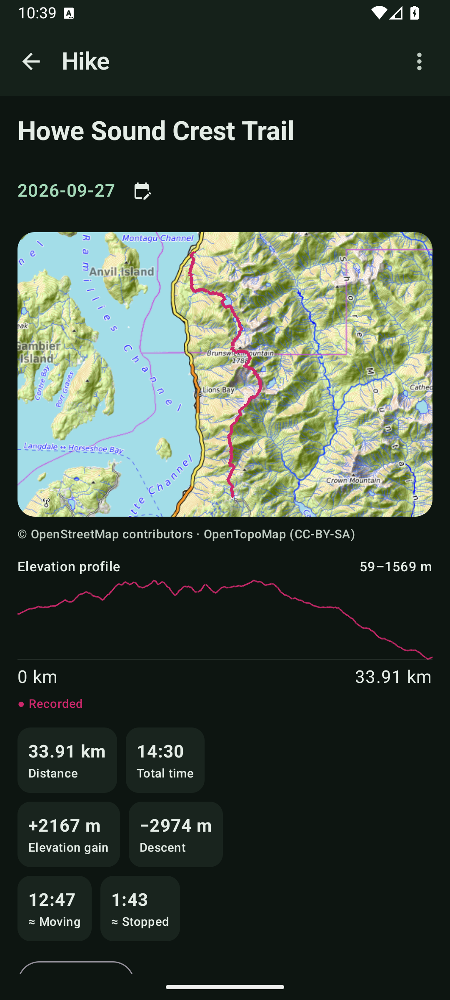
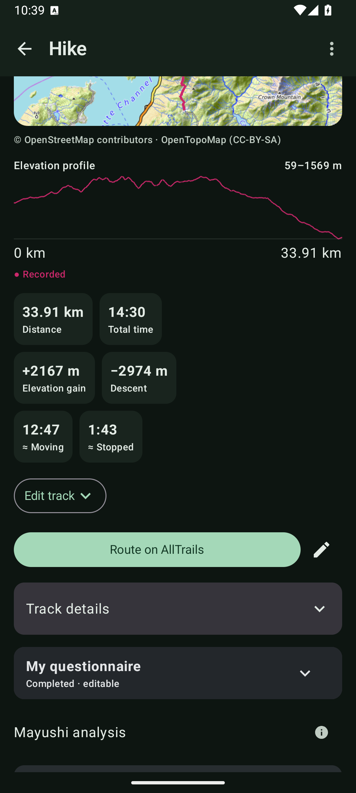
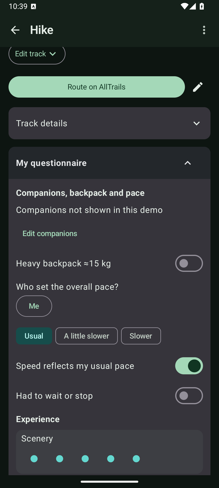
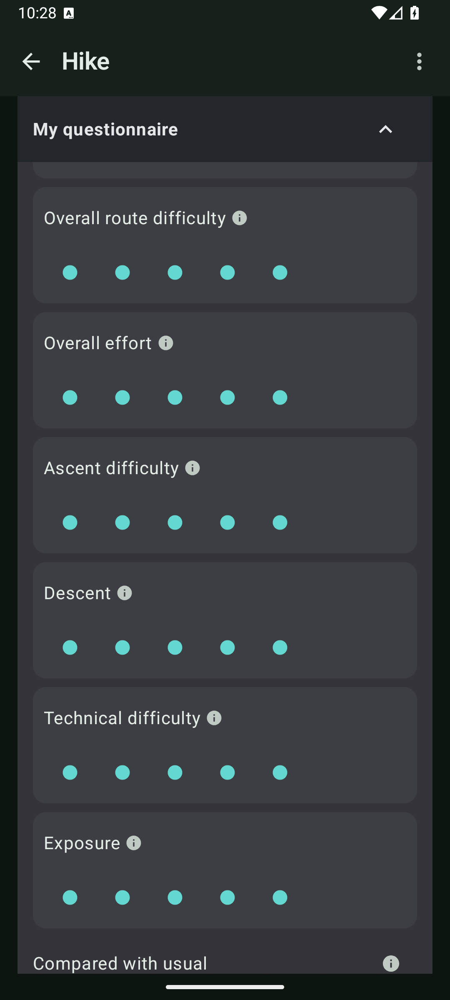
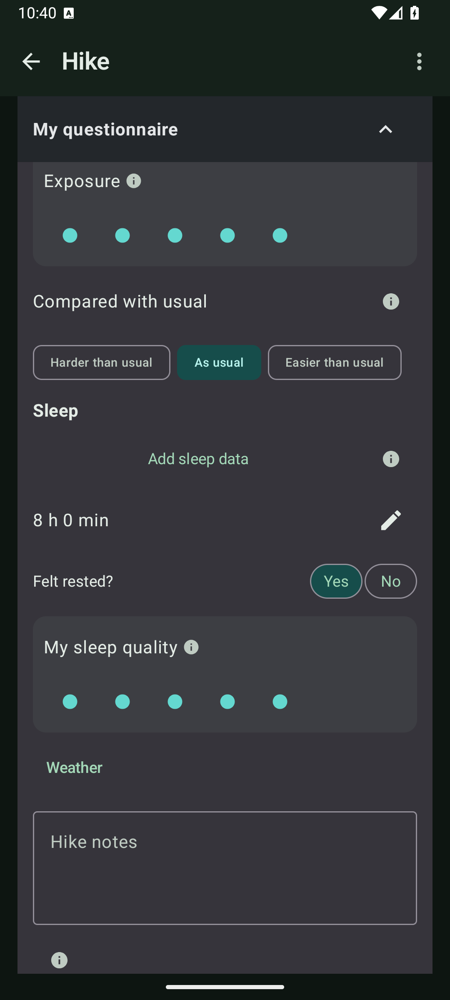
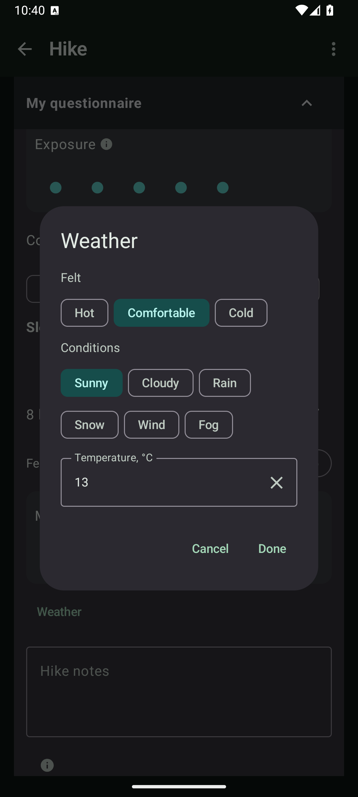
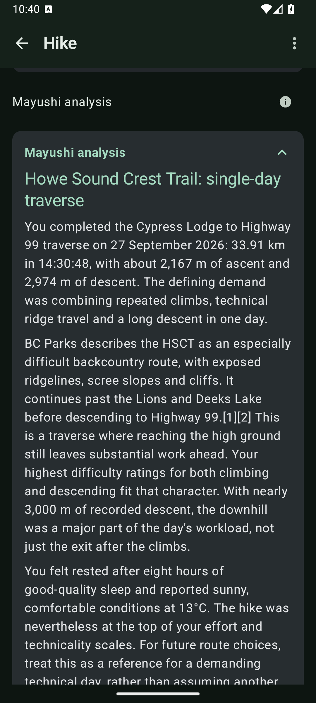
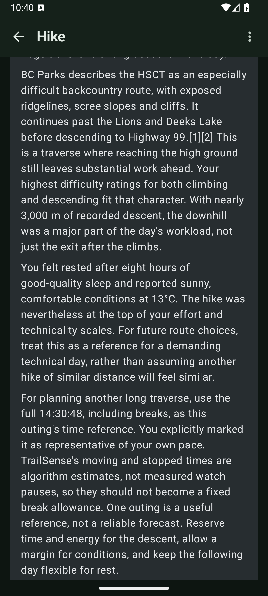

# TrailSense

**Hikes in the context of your life. A personal history, AI analysis, and a foundation for individual forecasts.**

The same route can feel different after a good night's sleep, during a stressful period, or on different days of a woman's menstrual cycle. Distance and elevation gain alone cannot describe that personal experience.

TrailSense brings together watch recordings, GPS tracks, personal ratings, and a context calendar. I made this app to collect a detailed individual history: the routes I have hiked, their metrics, how I felt, and the circumstances of each hike.

The project's main goal is to use that history to predict how long a future hike will take and how demanding it may be for me personally. **Personalized forecasting is planned.** Today, the app collects the data for it and helps me review completed hikes with my AI assistant, Mayushi, running on Hermes Agent.

## Demo

The example is my real Howe Sound Crest Trail hike, recorded with a HUAWEI WATCH GT 4. The screenshots and video use an isolated **English demo version. The current app is in Russian.**

This repository contains the **0.4.1** Russian-language application. The demo was recorded from an isolated English version of the same development build.

### Animated preview

[](docs/demo/TrailSense_HSCT_Demo_EN.mp4)

[Open the full MP4 video](docs/demo/TrailSense_HSCT_Demo_EN.mp4) · [Read the English hike analysis](docs/demo/HSCT_Analysis_EN.md)

The demo covers recording import, the route map and elevation profile, this hike's actual questionnaire with companion details redacted, and importing and viewing a new AI analysis. Waits and transitions shortened. The GIF above is an animated preview; the full video is available through the MP4 link.

### Screenshots

<p>
  
  
</p>
<p>
  
  
</p>
<p>
  
  
</p>
<p>
  
  
</p>

## Track correction

### Forgot to stop the workout

If a recording includes the drive home or extra waiting after a hike, you can select the boundaries and trim its beginning or end.

After trimming, the app recalculates the retained section's metrics:

- Distance on the recording's distance scale: cumulative watch distance reconciled with the recording total; if unavailable or inconsistent, GPS distance scaled to the watch's total distance; otherwise, GPS distance alone.
- Elevation gain and loss from the available measurements.
- Elapsed time from timestamps.
- Estimated moving and stopped time.
- Average pace from the new distance and moving time.
- Average and maximum heart rate from the remaining measurements, when available.

The map and elevation profile show the corrected route. The original recording is preserved. Resetting the correction restores the original track and the saved watch metrics.

### Forgot to start the workout

For an out-and-back route, the missing beginning can be inferred from the recorded return leg. The app matches track sections and proposes the missing path when it finds a sufficiently unambiguous match.

You can select the actual starting point on the map. If the missing section cannot be inferred from the recording itself, a separate option can build it using the mapped trail network.

The result is previewed on the map before saving. The inferred section is highlighted separately from the recorded track. Its distance is calculated from the constructed path, and elevation is estimated where it can be matched to available measurements. **Time and heart rate for the missing section remain unknown.**

**Unlike trimming, adding a missing beginning preserves every original watch summary metric:** distance, elevation gain and loss, time, pace, and heart rate. The added path is tracked separately and is not added to those values.

## Context calendar

The calendar records circumstances relevant to how demanding a hike feels:

- Days of the menstrual cycle.
- Insufficient sleep.
- Background stress and acute stress, including stress experienced during a hike.
- Personal notes.
- Extended and ongoing events.

The app supports menstrual cycle tracking through period entries or a contraceptive-pill tracking mode. For a prescribed regimen, you can store pill-taking and break periods, log actual doses, and configure reminders.

This provides context for comparing how different cycle days or pill regimens relate to perceived effort and other sensations, especially on repeated hikes of the same route.

Calendar events active on the day of the hike are included in the AI analysis request alongside the recording and questionnaire. A familiar route can be considered together with insufficient sleep, stress, and notes about how I felt, rather than just a rating of “that was hard.”

## Questionnaire and metrics

The questionnaire adds the circumstances of each hike to the measurements. It lets me:

- Rate overall exertion, route difficulty, ascent and descent difficulty, technical terrain, and exposure.
- Record views, impressions, and whether the hike felt harder or easier than usual.
- Record sleep duration, sleep quality, and how rested I felt.
- Select companions and note whose pace the group followed, or whether I hiked alone.
- Record pace constraints, how the speed compared with my usual pace, waiting, and forced stops.
- Note a heavy backpack of around 15 kg, including in the context of a multiday hike.
- Describe the weather, heat, cold, and related discomfort.
- Add free-form notes.

I enter weather and subjective experiences myself. Sleep duration can be recognized on the device from a screenshot of a sleep or watch app, then checked and corrected. Sleep quality and feeling rested are rated separately.

Available recording metrics include distance, elevation gain and loss, elapsed time, moving and stopped time, pace, and heart rate, where the data supports them. The questionnaire and notes are included in the AI analysis request so the measurements can be considered alongside personal experience.

## AI analysis with Mayushi

I review hikes with my personal AI assistant, Mayushi, running on Hermes Agent, in our Telegram chat.

TrailSense assembles a request from the selected recording, available watch metrics, questionnaire, and calendar context. I send the request to Mayushi in Telegram, receive an analysis file, and import it back into TrailSense. The analysis is saved and displayed alongside the hike.

The analysis connects route characteristics, pace, and heart rate with perceived exertion, sleep, and the circumstances of the hike. Comparative reviews help examine changes between repeated hikes of the same route.

## Maps and history

### Individual hike map

The app displays the route from the recording's GPS coordinates and its elevation profile. The map lets me examine route geometry and corrections, including a separately highlighted inferred beginning.

### All-hikes map

Saved hikes with GPS data appear on one map. I can see where I have hiked, select a track, and open its record. Where routes overlap or run close together, a list lets me choose the relevant hike.

### Repeated hikes

TrailSense identifies comparable recordings of the same route and lets me compare time, heart rate, and personal ratings. Each hike's context helps show the circumstances in which metrics and experiences changed on a familiar route.

## Technology and testing

Kotlin, Jetpack Compose, Room/SQLite, coroutines and Flow, WorkManager, OkHttp, ML Kit text recognition, and osmdroid maps. OpenStreetMap/OpenTopoMap sources are credited in the interface.

GPS recording import supports GPX and TCX. **Testing has been limited to HUAWEI WATCH GT 4; support for other devices is in development.**

This is a personal prototype under active development.

## Build locally

Requirements:

- JDK 17 with `JAVA_HOME` configured.
- Android SDK Platform 35 and the SDK build tools requested by Gradle.
- Android API 28 or later on a device or emulator.
- Network access to download dependencies.

Open the project in Android Studio, or configure the SDK through `ANDROID_HOME` or an untracked `local.properties` file containing `sdk.dir`.

```sh
git clone https://github.com/kseniatsuru-source/TrailSense.git
cd TrailSense
./gradlew assembleDebug
```

The debug APK is created in `app/build/outputs/apk/debug/`.

### Tests

```sh
./gradlew testDebugUnitTest
```

The project includes JUnit/Robolectric tests and Android instrumented tests. Some local acceptance checks require personal test data or a device with a populated database.

### Build signing

The release variant currently uses debug signing for checks on a personal device. Configure your own release signing before distribution. A build signed with a different key cannot update an installed app signed with the original key.

## Data and privacy

Recordings and questionnaires are stored locally. Requests sent to Mayushi contain the selected hike data, personal ratings, and context. Review their contents before sharing or publishing them.

This demonstration is limited to my Howe Sound Crest Trail hike. It excludes information about companions and other people, unrelated calendar entries, app databases, keys, and diagnostic reports.

## License

A license has not yet been selected for this project.
